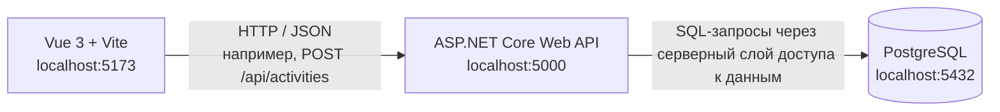

# Архитектура web-ИС семестра

## Назначение

Архитектура фиксирует разделение ответственности между клиентом, сервером и базой данных для цифрового профиля студента.

**архитектура web-ИС семестра**

## Ответственность узлов

**Vue 3 + Vite (localhost:5173)** отображает цифровой профиль, список записей об активности и формы создания. Клиент отправляет HTTP-запросы к API и отображает результаты. Бизнес-правила и прямой доступ к базе данных на стороне браузера не размещаются.

**ASP.NET Core Web API (localhost:5000)** принимает запросы, проверяет входные данные, права и допустимость переходов статусов, присваивает записи машинный `id` и человекочитаемый `number`, а затем обращается к базе данных. Например, при создании записи сервер устанавливает статус `New` и определяет автора по текущему пользователю, а не доверяет этим значениям из тела запроса.

**PostgreSQL (localhost:5432)** хранит пользователей, категории активности и записи об активности. Связи между сущностями обеспечиваются первичными и внешними ключами.

## Почему браузер не подключается к PostgreSQL

Браузер общается только с ASP.NET Core по HTTP. Если разрешить клиенту подключаться к PostgreSQL напрямую, пришлось бы раскрыть клиенту параметры доступа к базе, а проверки ролей и бизнес-правил можно было бы обойти. Серверный API централизует проверку данных и полномочий и не раскрывает браузеру учётные данные базы.
