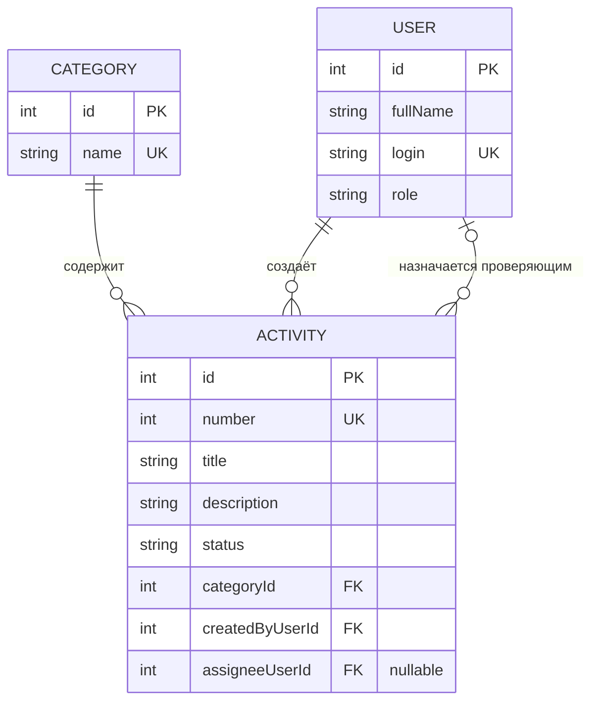

# Модель данных

## Словарь предметной области

| Термин курса | Термин проекта | Назначение |
|---|---|---|
| Ticket | Activity — запись об активности | Главный объект: достижение или образовательная, научная либо проектная активность студента |
| Site | Category — категория активности | Справочник типов активности, например «Учебная», «Научная», «Проектная» |
| User | User — пользователь | Студент, преподаватель-проверяющий или руководитель |

В документах и API используется термин `Activity`; он не заменяется на `Request` или `Ticket`.

## ER-диаграмма

### Связи

- **Один Category — много Activity (1:N).** Каждая запись об активности относится к одной существующей категории, а категория может использоваться во многих записях.
- **Один User создаёт много Activity (1:N).** `createdByUserId` ссылается на пользователя, создавшего запись.
- **Один User может быть назначен проверяющим для многих Activity (1:N).** `assigneeUserId` ссылается на пользователя-проверяющего. У новой записи исполнитель может отсутствовать, поэтому поле допускает `NULL`.

## Поля и ключи

### Activity — главная сущность

| Поле | Тип (логический) | Ограничения и назначение |
|---|---|---|
| `id` | integer | PK; уникальный машинный идентификатор, назначается сервером |
| `number` | integer | Уникальный человекочитаемый номер, отличается от `id`; назначается сервером |
| `title` | string | Заголовок длиной 5–80 символов, обязателен |
| `description` | string | Описание длиной 10–500 символов, обязательно |
| `status` | string/enum | Один из `New`, `InProgress`, `Closed`, `Cancelled`; при создании сервер устанавливает `New` |
| `categoryId` | integer | FK → `Category.id`, обязателен |
| `createdByUserId` | integer | FK → `User.id`, автор; определяется сервером по вошедшему пользователю |
| `assigneeUserId` | integer или NULL | FK → `User.id`, назначенный проверяющий; при создании может быть пустым |

### Category — справочник

| Поле | Тип (логический) | Ограничения и назначение |
|---|---|---|
| `id` | integer | PK |
| `name` | string | Уникальное название категории, обязательно |

### User — пользователь

| Поле | Тип (логический) | Ограничения и назначение |
|---|---|---|
| `id` | integer | PK |
| `fullName` | string | Отображаемое имя пользователя |
| `login` | string | Уникальный логин |
| `role` | string/enum | Роль: `Student`, `Reviewer` или `Manager` |

`id` является машинным ключом, а `number` — отдельным удобным номером записи. Значения фамилии, логина или названия не используются вместо PK.

## Проверка третьей нормальной формы (3НФ)

Название категории хранится в сущности `Category` один раз. В `Activity` хранится только внешний ключ `categoryId`, а не текстовое поле `categoryName`. При переименовании категории изменяется одна строка справочника, поэтому название не дублируется в каждой записи. Аналогично, данные пользователя хранятся в `User`, а в `Activity` находятся только ссылки `createdByUserId` и `assigneeUserId`. Поля сущностей зависят от ключа своей таблицы, неключевые поля не дублируют сведения из связанных сущностей. Это соответствует принятой для курса проверке 3НФ.

## Правила целостности

- `Activity.categoryId` и `Activity.createdByUserId` обязательны и должны ссылаться на существующие записи.
- `Activity.assigneeUserId` допускает `NULL`; если значение задано, пользователь должен существовать.
- `Activity.number` уникален и не заменяет `id`.
- Начальный статус новой записи — `New`. Допустимые статусы: `New`, `InProgress`, `Closed`, `Cancelled`.
- Отмена фиксируется статусом `Cancelled`, а не удалением записи.
